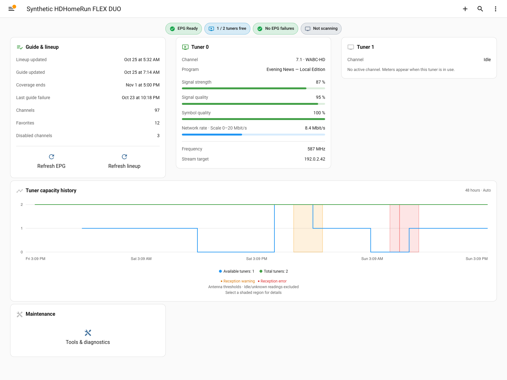

# HDHomeRun for Home Assistant

See what's playing, check reception quality, and keep an eye on available tuners
without leaving Home Assistant. Connect your SiliconDust HDHomeRun receiver for
live tuner statistics, a bundled dashboard, and an optional cached XMLTV guide
and M3U playlist for compatible players.

[Installation guide](docs/installation.md) · [See the dashboard](#dashboard)

This is the **maintained fork by
[rtgibbons](https://github.com/rtgibbons)** of
[uvjim/hass_hdhomerun](https://github.com/uvjim/hass_hdhomerun), with additional
dashboard, guide, and diagnostic features. The original integration was developed
by [uvjim](https://github.com/uvjim) and its contributors. This is a custom
integration, not a Home Assistant app/add-on or an official SiliconDust product.

## Features

- **Receiver and tuner monitoring:** channel, program, signal strength and
  quality, network rate, available tuners, and firmware information.
- **Bundled dashboard:** compact tuner cards, guide health, responsive capacity
  history, and reception warning/error overlays. No separate card installs.
- **Optional XMLTV and M3U proxy:** cached guide data and a matching channel
  playlist for compatible players, with freshness and failure diagnostics.
- **Device controls:** refresh the lineup or guide, scan channels, and restart
  the receiver. Dashboard maintenance actions ask for confirmation.
- **English localization:** US and British display text, with Home Assistant
  language, clock, and sensor-unit preferences respected.

Available entities depend on receiver capabilities and discovery method.

## Quick start

Requires **Home Assistant 2026.1.0 or later**,
[HACS](https://www.hacs.xyz/), and network access to your HDHomeRun receiver.

1. In HACS, open **Custom repositories** and add
   `https://github.com/rtgibbons/hass_hdhomerun` as an **Integration**.
2. Download **HDHomeRun for Home Assistant**, choosing the latest stable release,
   then restart Home Assistant.
3. Open **Settings → Devices & services → Add integration** and search for
   **HDHomeRun for Home Assistant**. Enter the receiver's IP address, or leave
   it blank to discover receivers.
4. To add the optional dashboard, follow the [dashboard setup](#dashboard) below.

> **Install only one HDHomeRun custom integration.** This fork and upstream use
> the same `hdhomerun` domain and cannot be installed side-by-side. Existing users
> should back up Home Assistant before switching sources.

[Installation and configuration guide](docs/installation.md)

## Dashboard

Add the dashboard once; future integration updates deliver its managed layout
and cards. Each receiver gets an overview and a maintenance subview. Nothing is
automatically added to your sidebar, and installation does not show a prompt.

*Actual Home Assistant capture with synthetic receiver and history data.*

On **Home Assistant 2026.5 or later**, restart after installation, **hard refresh
your browser**, then open **Settings → Dashboards → Add dashboard → Community
dashboards → HDHomeRun**. Choose whether to show it in the sidebar.

Earlier supported versions can use the
[blank-dashboard configuration](docs/dashboard.md#add-the-dashboard).

The full-width history chart adapts to 24, 36, or 48 hours of available space,
with integer tuner counts and translucent reception alerts. Keeping the
dashboard managed preserves layout updates; **Take control** creates a static,
user-owned layout instead.

[Dashboard guide: customization, updates, and alert thresholds](docs/dashboard.md)

## Documentation

| Guide | What you will find |
| --- | --- |
| [Installation and configuration](docs/installation.md) | HACS setup, discovery, polling, and receiver options |
| [Dashboard](docs/dashboard.md) | Add-once workflow, managed vs. custom layouts, history, and localization |
| [XMLTV guide and M3U playlist](docs/epg.md) | Player setup, cache behavior, diagnostics, and URL security |
| [Entity reference](docs/entities.md) | Sensors, buttons, controls, and capability requirements |
| [Troubleshooting](docs/troubleshooting.md) | Browser refresh, missing entities, guide failures, and debug logs |
| [2026.10.1 release notes](docs/releases/2026.10.1.md) | Release highlights, upgrade steps, and rollback |
| [Release preparation](docs/releasing.md) | Branch model, validation, licensing research, and publication gates |

See the [documentation index](docs/README.md) for a suggested reading order.

The **Validate** badge covers tests, lint, and Home Assistant manifest validation.
**HACS: Custom** describes the installation channel, not certification.
[HACS eligibility](https://github.com/rtgibbons/hass_hdhomerun/actions/workflows/hacs.yml)
is checked separately for default-list submission, not custom-install releases.

## Support and upstream

Report fork-specific problems in
[this repository's issue tracker](https://github.com/rtgibbons/hass_hdhomerun/issues).
Include your Home Assistant version, receiver model, discovery method, and
redacted diagnostics. **Never publish XMLTV/M3U URLs or receiver authentication
values**; see [safe troubleshooting](docs/troubleshooting.md#collect-diagnostics).

This fork is maintained by [rtgibbons](https://github.com/rtgibbons); direct
fork-specific support requests here rather than to the upstream maintainer.
The original integration's history and contributors remain available in the
[upstream repository](https://github.com/uvjim/hass_hdhomerun). Attribution does
not imply upstream endorsement of this fork.
