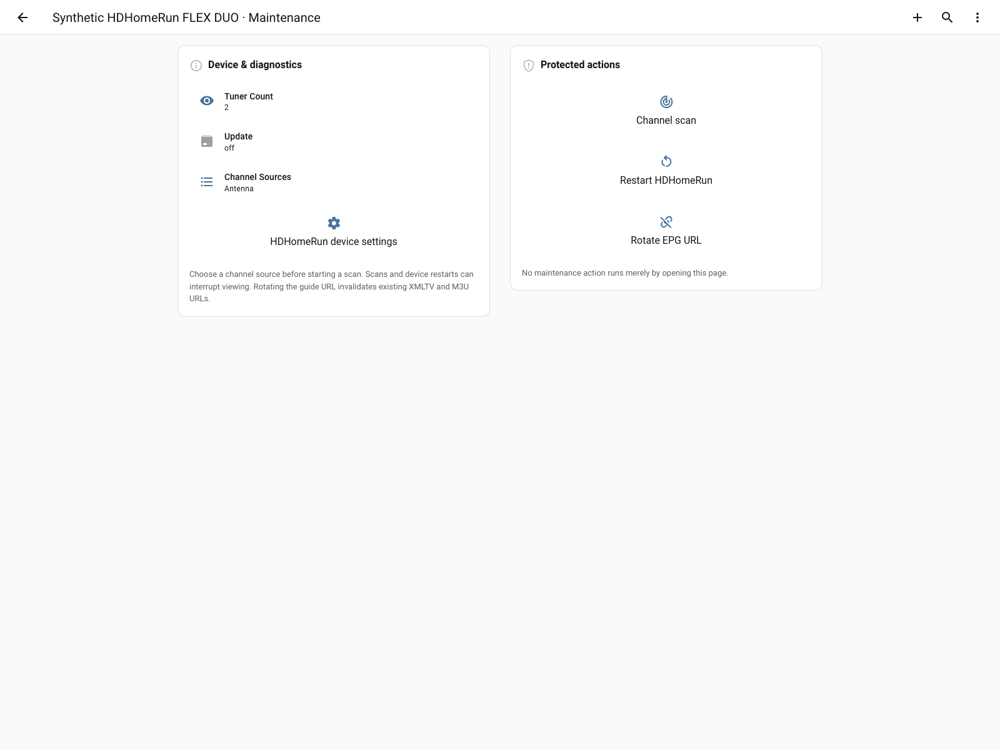

# Dashboard

[Documentation index](README.md) · [Installation](installation.md)

The integration bundles its own dashboard strategy and cards. No separate HACS
card downloads or manual resource registration are needed. The dashboard is
optional: it is not created automatically, and there is no installation prompt.

## Add the dashboard

After installing or updating the integration, restart Home Assistant and **hard
refresh your browser** so it loads the bundled frontend module.

On **Home Assistant 2026.5 or later**:

1. Open **Settings → Dashboards → Add dashboard**.
2. Under **Community dashboards**, choose **HDHomeRun**.
3. Choose a title, icon, and whether to show it in the sidebar.

On earlier supported versions, create a new blank dashboard and replace its raw
configuration with:

```yaml
strategy:
  type: custom:hdhomerun
```

Add it once. Subsequent integration updates do not require recreating it.

## Overview


*Captured in actual Home Assistant with synthetic test data; see
[screenshot provenance](../images/dashboard/README.md).*

Each receiver gets its own overview and maintenance subview. The strategy finds
HDHomeRun entities through Home Assistant's entity registry, including renamed
entity IDs, and keeps multiple receivers separate.

- Health badges summarize guide status, capacity, failures, and scanning.
- Guide and lineup timestamps appear above channel counts and refresh buttons.
- Each tuner has one compact card with status, program, meters, and details.
  Active tuner icons are green; idle icons are gray.
- Full-width capacity history shows available and total tuners.
- **Tools & diagnostics** opens maintenance without cluttering the overview.

Missing, disabled, or hidden entities are omitted. Enable desired entities under
**Settings → Devices & services**; the dashboard never enables them itself.
Guide-specific content appears only when the XMLTV proxy is enabled.

## Updates and customization

| Change | What happens on an integration update |
| --- | --- |
| Dashboard title, icon, or sidebar visibility | Your settings remain yours |
| Strategy configuration, such as `signal_profile` | Saved settings are retained; the layout is generated |
| Managed layout | Receives bundled layout and card improvements |
| **Take control** | Saves a static layout; generated layout improvements stop, but bundled card code still updates |
| Other user-created dashboards | Not modified by the integration |

To receive managed layout updates, keep the `strategy` configuration. If you
want a fully customized layout, take control of a copy and keep a second managed
dashboard for comparison. After HACS updates, restart HA and refresh the browser.

## Capacity history and reception alerts

The chart uses stepped lines and whole-number tuner counts. Its history window
depends on the **chart width**, not a user-selected duration:

| Chart width | History window |
| --- | --- |
| Less than 600px | 24 hours |
| 600px to less than 1000px | 36 hours |
| 1000px or wider | 48 hours |

History requires Home Assistant's History/Recorder integrations, recorded source
entities, and retention covering the period. Unavailable data produces gaps
rather than invented readings.

Reception warnings and errors appear as translucent regions behind the lines.
Select a region, or focus it and press **Enter** or **Space**, for its readings
and time interval. Each interval reflects the worst observed active-tuner
condition; idle and unknown readings are excluded.

| Metric | Warning | Error |
| --- | --- | --- |
| Signal quality | Below 70% | Below 50% |
| Symbol quality | — | Below 100% |
| Signal strength: antenna profile | Below 75% | Below 50% |
| Signal strength: cable profile | Below 90% | Below 80% |

Strength thresholds are **off by default** because the integration cannot
reliably infer your source. To enable them, edit the managed dashboard's raw
strategy configuration and choose `antenna` or `cable`:

```yaml
strategy:
  type: custom:hdhomerun
  signal_profile: antenna
```

The thresholds follow
[SiliconDust's signal-color implementation](https://github.com/Silicondust/libhdhomerun/blob/master/hdhomerun_device.c),
not a guarantee of picture quality. Error severity takes precedence over warning.
The network-rate meter's labeled **20 Mbit/s scale** is a display scale, not a
bandwidth limit; it converts to the sensor's selected unit.

## Maintenance



Choose a channel source before scanning. Channel scans and receiver restarts can
interrupt viewing or recordings; rotating the guide URL invalidates existing
XMLTV and M3U links. These dashboard actions require confirmation. **Opening the
page never executes an action.** Restart HDHomeRun restarts the receiver, not HA.

## Language, dates, and units

Dashboard text follows each viewer's language: `en` uses **Program/Favorites**
and `en-GB` uses **Programme/Favourites**. Dates use short month/day/time labels
and respect Home Assistant's clock and timezone preferences. Meters preserve
selected sensor units.

Native entity names follow HA's **instance language**, not each browser's
language. Entity IDs, unique IDs, and user-assigned names are preserved, including
legacy spellings when generating new entity IDs. Device-provided titles are not
translated.

Older frontends without strategy regeneration support, including HA 2026.2,
need a reload after a language change to refresh generated section labels.

See [mobile and British English screenshots](../images/dashboard/README.md)
for additional views.
